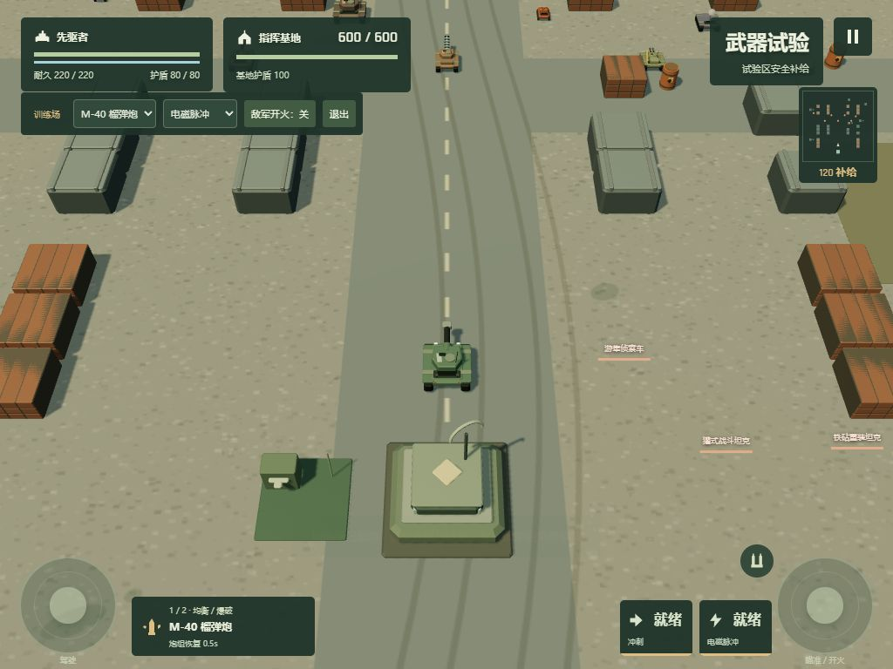

# 钢铁防线 · STEEL FRONTIER

原创单人浏览器坦克动作防守游戏。高位俯视跟随镜头、自由驾驶、独立炮塔瞄准、可破坏战场、分支战役、装备构筑与最终 Boss。



## 启动

需要 Node.js 22.12 或更高版本。首次运行：

```powershell
git clone https://github.com/Mesting42/steel-frontier.git
cd steel-frontier
npm ci
npm run dev -- --port 5173
```

本地地址：<http://localhost:5173/>。也可以双击 `启动游戏.cmd`。手机与电脑连接同一局域网后，可使用 Vite 输出的 Network 地址访问；是否能访问取决于 Windows 防火墙及网络隔离设置。

## 构建与静态部署

```powershell
npm run build
npm run preview -- --port 4173
```

`dist/` 是可独立托管的完整静态网站。Cloudflare Pages 的构建命令为 `npm run build`，输出目录为 `dist`。正式游玩不访问账号、后端、远程素材或 AI 接口。请通过 HTTP 服务访问，浏览器不支持直接双击 `dist/index.html` 的模块加载方式。

## 操作

| 操作                  | 电脑             | 手机 / 平板 |
| --------------------- | ---------------- | ----------- |
| 自由移动              | WASD             | 左摇杆      |
| 炮塔瞄准              | 鼠标             | 右摇杆      |
| 持续射击              | 按住鼠标左键     | 推动右摇杆  |
| 冲刺                  | Space            | 冲刺按钮    |
| 主动技能 / 维修站交互 | E                | 技能按钮    |
| 切换主武器            | Q                | 换炮按钮    |
| 暂停                  | Esc / 右上角暂停 | 右上角暂停  |

触屏设备使用横屏；竖屏时暂停当前战斗并显示方向引导。设置中可调整摇杆尺寸、透明度、图形质量、受击震动与两类音量。窗口失焦或切后台会暂停，返回后需明确继续。

## 模式与规则

- **战役**：三个区域六场战斗，每场三波；路线决定额外敌军、精英、补给、修理和事件。战后选择强化并进入商店，最后击败“堡垒”攻城指挥车。
- **无尽防守**：九张地图任选，每三波进入强化与整备，保存本地最高波次和成绩。
- **训练场**：全部六种武器和四种技能可以直接试用，支持切换敌军开火，维修站免费。

六种主炮：榴弹炮、双联速射炮、穿甲磁轨炮、散射破片炮、蜂群导弹架、电弧发生器。最多携带两种，第三种需要选择替换槽位。主动技能四选一。十五种被动强化支持不同战斗方向。

护盾先吸收伤害，剩余部分扣除车体耐久。玩家脱离伤害五秒后恢复护盾。基地固定装甲吸收 45% 敌方伤害，并拥有缓慢恢复的独立护盾。玩家武器及环境连锁爆炸不伤己方基地；敌方攻击会伤害基地。玩家或基地耐久归零均结束本局。

砖墙、沙袋、燃料桶和废弃车辆可摧毁；钢墙和岩体不可摧毁。水渠阻挡移动但不阻挡炮弹。泥地减速，冰面增加适量滑动。炮口被钢墙挡住时需要移动打开射界。

## 存档

记录保存在浏览器 `localStorage` 的 `steel-frontier:v1:` 命名空间。安全检查点包含装备、强化、补给、基地和车体状态，在整备点和进入战斗前保存。继续战役重新部署到该战斗起点，不恢复危险帧。通关或失败后结束本局并清除当前战役检查点；本地纪录与设置保留。

不同浏览器、不同域名和不同端口拥有独立存档。清理网站数据会删除本地纪录。浏览器禁止本地存储时仍能游玩，但无法跨刷新保存。

## 验证

```powershell
npm test
npx tsx tests/campaign-run.ts
npm run build
```

开发服务器提供 [浏览器验收台](http://localhost:5173/qa.html)，可运行键鼠与双指输入、暂停、恢复和六战自动输入实战。自动实战明确标注 12 倍模拟速度，只使用正常驾驶、瞄准、射击、技能和界面操作，不修改生命、不跳关、不调用胜利入口。生产构建移除自动驾驶分支；验收台不进入 `dist`。

详细测试证据见 [docs/测试报告.md](docs/测试报告.md)，系统关系和扩展方式见 [docs/交接文档.md](docs/交接文档.md)，资源归属见 [docs/素材说明.md](docs/素材说明.md)。
